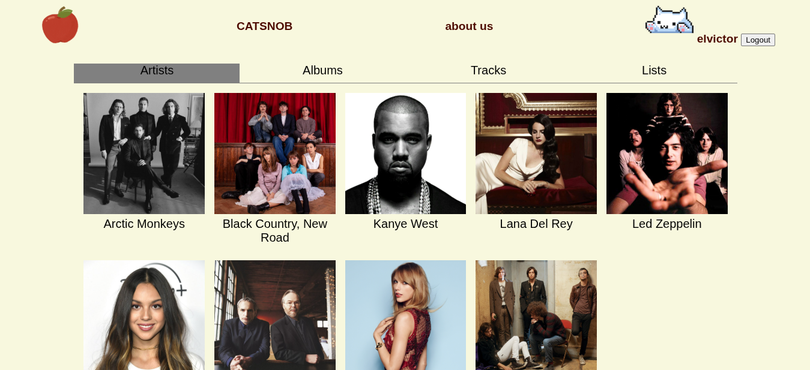
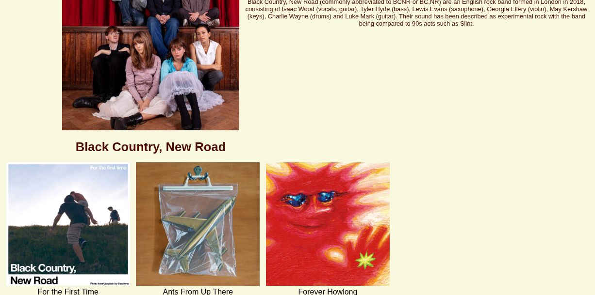
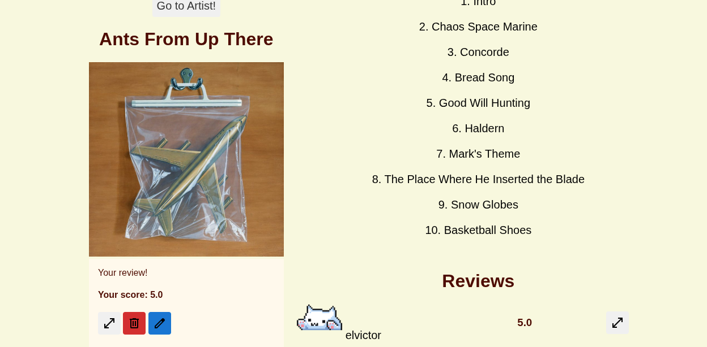
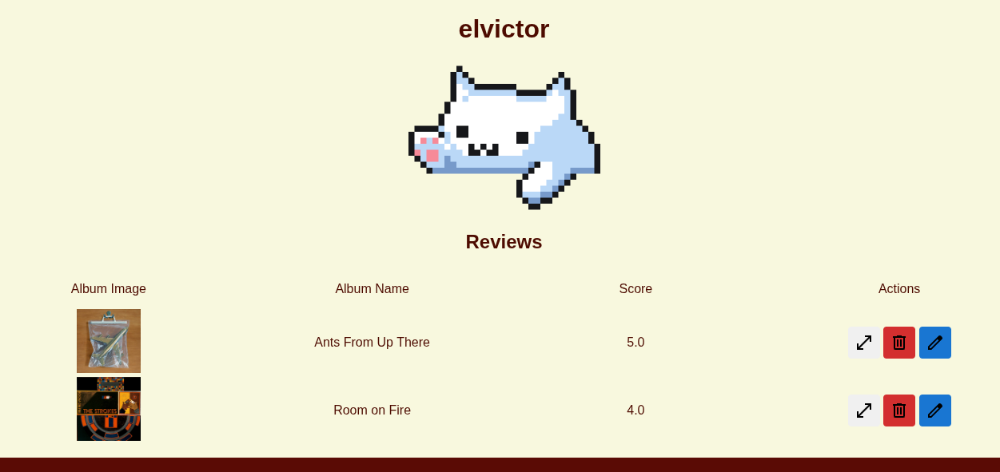

# 🐱🎵 Catsnob

```
                  888                               888      
                  888                               888      
                  888                               888      
 .d8888b  8888b.  888888 .d8888b  88888b.   .d88b.  88888b.  
d88P"        "88b 888    88K      888 "88b d88""88b 888 "88b 
888      .d888888 888    "Y8888b. 888  888 888  888 888  888 
Y88b.    888  888 Y88b.       X88 888  888 Y88..88P 888 d88P 
 "Y8888P "Y888888  "Y888  88888P' 888  888  "Y88P"  88888P"  
```

Catsnob es una plataforma web desarrollada como prototipo para un proyecto de base de datos. Permite explorar, agregar y revisar música (artistas, álbumes y canciones) utilizando [TheAudioDB API](https://www.theaudiodb.com/free_music_api). Los datos se almacenan en una base de datos PostgreSQL, y la interfaz permite a los usuarios interactuar con el contenido musical, escribir reseñas y crear listas personalizadas.

> Este proyecto es un **prototipo académico**, no orientado a producción. Usa muy poco JavaScript, sin frameworks, y está hecho casi completamente en **Go (Golang)**.

---

## Características principales

- Exploración de artistas, álbumes y canciones usando TheAudioDB.
- Sistema de autenticación con JWT y contraseñas hasheadas.
- Creación de usuarios y sistema de roles (requiere ser admin desde SQL).
- CRUD de reseñas de álbumes.
- Comentarios en reseñas (también con CRUD).
- Sistema de listas de álbumes y canciones personalizadas.
- Comunicación directa con la API externa de TheAudioDB.
- Basado en PostgreSQL.

---

## Capturas de pantalla (Sugerencia)

Puedes agregar imágenes aquí para mostrar el funcionamiento de la app:

- Página principal con artistas destacados.

- Página de artista con sus álbumes.

- Página de álbum con canciones y reseñas.

- Vista del perfil de usuario.


---

## Instalación y configuración

### 1. Instala PostgreSQL

#### macOS
```bash
brew install postgresql@15
```

#### Linux / WSL
```bash
sudo apt update
sudo apt install postgresql postgresql-contrib
```

### 2. Configura PostgreSQL

#### Linux
Cambia la contraseña del usuario postgres:
```bash
sudo passwd postgres
```

### 3. Inicia el servidor PostgreSQL

- **macOS**:  
  ```bash
  brew services start postgresql@15
  ```

- **Linux**:  
  ```bash
  sudo service postgresql start
  ```

### 4. Conéctate al servidor

Usa `psql` o cualquier cliente GUI como PGAdmin:

```bash
sudo -u postgres psql
```

### 5. Crea la base de datos

```sql
CREATE DATABASE catsnob;
\c catsnob
```

### 6. (Linux) Cambia la contraseña

```sql
ALTER USER postgres PASSWORD 'postgres';
```

### 7. Verifica conexión

```sql
SELECT version();
```

---

## Estructura de la base de datos

Tablas utilizadas:

- `users`: usuarios de la plataforma con autenticación.
- `artists`: información de artistas.
- `albums`: álbumes asociados a artistas.
- `tracks`: canciones de cada álbum.
- `album_reviews`: reseñas de álbumes.
- `shouts`: comentarios a reseñas.
- `user_lists`: listas creadas por usuarios.
- `album_lists`: álbumes incluidos en listas.
- `track_lists`: canciones incluidas en listas.
- `artist_follows`: seguimiento de artistas (No se llego a implementar).
- `goose_db_version`: control de migraciones con goose.

---

## Uso de la aplicación

### Crear usuario

Desde la interfaz web puedes registrarte como usuario. Sin embargo, para ser **admin**, debes editar la base de datos directamente:

```sql
UPDATE users SET is_admin = TRUE WHERE username = 'tu_usuario';
```

### Agregar artista desde TheAudioDB

1. Visita: [TheAudioDB API](https://www.theaudiodb.com/free_music_api)
2. Busca un artista y copia su `idArtist`.
3. Ingresa como usuario admin a:  
   ```
   http://<tu_dominio>/admin/createArtistDisc
   ```
4. Pega la ID y listo. Se agregarán automáticamente:
   - El artista.
   - Todos sus álbumes.
   - Todas las canciones de esos álbumes.

---

## Funcionalidades interactivas

### Menú principal

- **Ver Artistas** → Página con todos los artistas registrados.
- **Ver Álbumes** → Página de navegación de álbumes.
- **Ver Canciones** → Catálogo de todas las canciones.

Cada artista tiene su propia página con sus álbumes, y cada álbum muestra su lista de canciones.

---

### Página de Álbum

- Crear/editar/eliminar reseñas.
- Ver reseñas de otros usuarios.

### Página de Reseñas

- Comentar una reseña.
- CRUD de comentarios (solo por el autor del comentario).

### Página de Usuario

- Tus reseñas.

### Listas

- Crear listas de álbumes o canciones.
- Agregar/eliminar contenido.
- Ver listas de otros usuarios.

---

## Seguridad

- Autenticación por JWT (JSON Web Tokens).
- Contraseñas hasheadas (bcrypt).
- Control de permisos básico (admin vs usuario normal).

---

## Advertencia

Este proyecto es solo un **prototipo académico**, no está diseñado para ambientes de producción ni para contener datos sensibles. No se usaron frameworks web modernos deliberadamente, y el uso de JavaScript fue mínimo para enfocarse en la lógica del backend y la base de datos.

---

## Licencia

Este proyecto es de uso académico. Puedes reutilizarlo, modificarlo y aprender de él, pero no se garantiza soporte ni seguridad.

---

Desarrollado como proyecto final para la clase de **Bases de Datos**.
